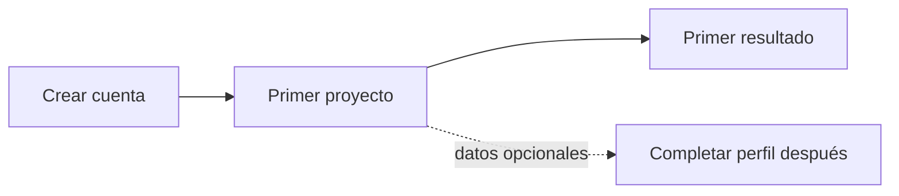

## Cómo queda el flujo

## Alternativas descartadas

| Alternativa | Por qué se descartó |
|---|---|
| Mantener cinco pasos y mejorar el copy | El abandono bajó solo 3 puntos en la Prueba A/B |
| Un solo paso | Perdíamos datos necesarios para personalizar |
