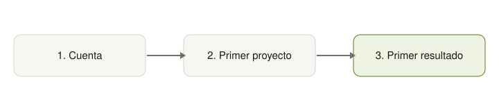

## Entrevistas

Doce entrevistas a usuarios nuevos. El hallazgo principal: el paso 2 pedía datos que el usuario aún no tenía a mano.

<Chart type="hbar" title="Motivos de abandono mencionados" src="../datos/motivos-abandono.csv" caption="Doce entrevistas; una persona puede mencionar más de un motivo." />

## El flujo nuevo

<Frame caption="Los tres pasos del onboarding nuevo">
  
</Frame>
